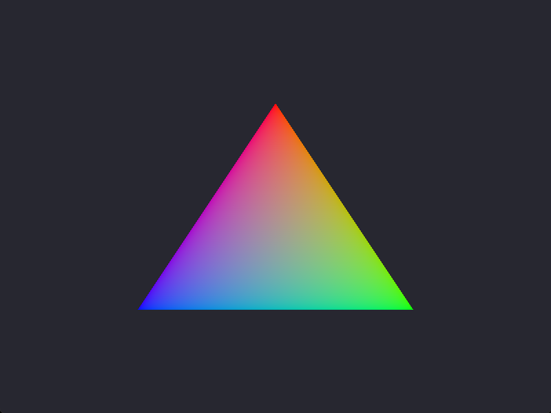

# Vulkan examples (Rust, ash)

**Quick start** (in this folder): `cargo run --release --bin 01_instance`. Requirements, validation tips and the
step -> lesson table: [Build the examples](../../README.md#build-the-examples) in the repository README.

Companion code for the Vulkan textbook. Each lesson step is one self-contained
binary in `src/bin/`: it repeats the previous steps, so you can read a single
file top to bottom. Code embedded in the lessons is marked with
`// #region <name>` ... `// #endregion` comments.

## Requirements

- Rust 1.85+ (edition 2024)
- A GPU driver with Vulkan 1.4 support (the examples refuse older devices)
- The [Vulkan SDK](https://vulkan.lunarg.com) - it provides the validation layer
  `VK_LAYER_KHRONOS_validation`, which steps 02-05 require

The crate uses [`ash`](https://github.com/ash-rs/ash) pinned to a master commit
(`f4c2ca3`, Vulkan-Headers 1.4.352) instead of the crates.io release: the latest
release, 0.38 (2024), only has Vulkan 1.3 bindings. Master renames a few APIs
(`push_next` is now `push` from `vk::TaggedStructure`, extension `::new` is
`::load`). It loads `vulkan-1.dll` at runtime, so no Vulkan SDK is needed to build.

Steps 06+ open a window with [`winit`](https://github.com/rust-windowing/winit) `=0.30.13`
(the latest stable release; ApplicationHandler API: winit calls the program back, and
windows are created in `resumed`) and create the Vulkan surface with `ash-window`,
taken from the same ash git commit (the crates.io ash-window 0.13 is built against
crates.io ash 0.38, whose types would not match).

Steps 08+ use the SPIR-V in `../../shaders/spv/` (`triangle.spv` for 08-12, `mesh.spv` with vertex input
for 14-15), compiled from `../../shaders/*.slang`.
It is committed, and embedded with `include_bytes!`, so building needs no shader compiler.
After editing a `.slang` file run `bun run sync:shaders` in the repository root (needs the
Vulkan SDK: slangc + spirv-val); `tests/shaders.test.ts` fails if the .spv is stale.

## Run

```
cargo run --bin 01_instance
```

## Steps

| Binary | What it does |
|---|---|
| `01_instance` | Load the Vulkan loader, list extensions, create and destroy an instance |
| `02_validation` | Enable the validation layer and a debug messenger |
| `03_physical_devices` | Enumerate GPUs, print properties, features and limits, pick one |
| `04_queue_families` | List queue families, find graphics / transfer / compute families |
| `05_logical_device` | Create a logical device with Vulkan 1.3 features (on a Vulkan 1.4 GPU) and fetch a queue |
| `06_window_surface` | Window (winit), surface extensions, `VkSurfaceKHR`, graphics + present family, surface capabilities, formats and present modes |
| `07_swapchain` | Device with `VK_KHR_swapchain`; choose format, present mode, extent, image count; swapchain and image views |
| `08_pipeline` | Slang shaders as SPIR-V, shader module, empty pipeline layout, graphics pipeline with dynamic rendering |
| `09_triangle` | Command pool and buffer, fence + semaphores, the frame loop (acquire, record, submit, present): the first triangle |
| `10_frames_in_flight` | One command buffer, fence and acquire semaphore per frame in flight (`--frames 1\|2\|3`); simulated CPU/GPU work (`--cpu-ms`, `--draws`) and fence-wait statistics |
| `11_resize` | Resizable window: swapchain recreation on resize / OUT_OF_DATE / SUBOPTIMAL with `oldSwapchain`, present fences (`VK_KHR_swapchain_maintenance1`) and a retire list, or `--no-present-fences` (vkDeviceWaitIdle); minimized = paused; `--demo-resize` |
| `12_timeline` | One timeline semaphore instead of the fences; binary semaphores stay for acquire/present; offscreen 400x300 image blitted to the swapchain with four exact sync2 barriers |
| `13_memory_types` | Memory heaps and types, memory limits, `vkGetBufferMemoryRequirements` for six buffer usages, the find-memory-type rule (required + preferred flags), allocate/bind/map a HOST_VISIBLE buffer, two buffers in one allocation. No window |
| `14_vertex_buffer` | Indexed hexagon from a vertex buffer + index buffer in HOST_VISIBLE \| HOST_COHERENT memory; vertex input bindings/attributes (`shaders/mesh.slang`); `vkCmdDrawIndexed`; 2 frames in flight |
| `15_staging` | The same mesh in DEVICE_LOCAL buffers: staging buffer + `vkCmdCopyBuffer` on the graphics queue (default), on the dedicated transfer queue with a queue family ownership transfer (`--transfer-queue`), or direct CPU writes into DEVICE_LOCAL \| HOST_VISIBLE memory (`--bar`); `--mib N` pads the vertex buffer to measure bandwidth; the upload is timed |
| `16_allocator` | N buffers (`--count`, default 3000) with one `vkAllocateMemory` each vs. sub-allocated from 64 MiB blocks by a minimal linear allocator in the file; counts and timings; prints `maxMemoryAllocationCount`. No window |
| `17_uniforms` | A per-frame transform (rotation + aspect matrix, tint, time) in one uniform buffer per frame in flight (persistently mapped); descriptor set layout, pool, two sets, `vkUpdateDescriptorSets`, `vkCmdBindDescriptorSets`; the std140 block layout is read from the SPIR-V (`shaders/transform.slang`) and checked against the host struct |
| `18_push_constants` | The same 80-byte block as push constants (`vkCmdPushConstants`, default) or step 17's uniform buffers bound with push descriptors (`--push-descriptor`, `vkCmdPushDescriptorSet`, Vulkan 1.4 feature `pushDescriptor`); prints `maxPushConstantsSize` / `maxPushDescriptors` and compares the setup of the three ways |
| `19_buffer_device_address` | 64 instances read their records through a GPU pointer: `bufferDeviceAddress`, `SHADER_DEVICE_ADDRESS` buffer, `DEVICE_ADDRESS` allocation, `vkGetBufferDeviceAddress` passed as a push constant (`Instance*` in `shaders/device_address.slang`); one instanced draw |
| `20_bindless` | Descriptor indexing: one set with a variable-count array of storage buffers (one per instance), partially bound, update-after-bind; `NonUniformResourceIndex` in `shaders/bindless.slang`; prints the descriptor limits; streams the 64th buffer into the live set at frame 120 |
| `21_texture` | Procedural 256x256 RGBA8 texture (no image file), format support via `vkGetPhysicalDeviceFormatProperties2`, `R8G8B8A8_SRGB` OPTIMAL image, staging upload with `vkCmdCopyBufferToImage2` between two sync2 layout transitions, image view, sampler (`--nearest`, `--address repeat\|mirror\|clamp\|border`, anisotropy 16), combined image sampler at set 0 binding 1 (`shaders/textured.slang`) |
| `22_depth` | Two intersecting cubes (`shaders/cube.slang`, 2 instances) with a perspective projection into Vulkan clip space; depth format chosen from D32_SFLOAT / D24_UNORM_S8_UINT / D16_UNORM; one depth image shared by the frames in flight with a WAW barrier per frame; pipeline depth state; `--no-depth` |
| `23_mipmaps` | 512x512 checkerboard floor receding to the horizon; full mip chain (10 levels) generated on the GPU with `vkCmdBlitImage2` and per-level barriers; trilinear sampler; `--no-mips` (maxLod 0), `--anisotropy` |
| `24_msaa` | Step 22 with MSAA: sample count from `framebufferColorSampleCounts & framebufferDepthSampleCounts` (`--samples 1\|2\|4\|8`, default 4), transient multisampled color + depth (LAZILY_ALLOCATED if offered, else DEVICE_LOCAL), resolve into the swapchain image via dynamic rendering (`resolveMode` AVERAGE) |
| `25_compute` | Compute pipelines: SAXPY over N elements (`--count`, default 1000000) and a groupshared workgroup reduction (`shaders/saxpy.slang`, `shaders/reduce.slang`); workgroup size read from the SPIR-V (LocalSize), compute limits + subgroupSize, ceil-div dispatch, storage-buffer descriptor sets, COMPUTE -> HOST barrier, readback from HOST_CACHED memory (`--uncached` to compare), GPU timestamps, exact CPU verification. No window |
| `26_particles` | 2^20 particles (`--count`) in one DEVICE_LOCAL buffer used as STORAGE_BUFFER and VERTEX_BUFFER: initialized and simulated by compute shaders (`shaders/particles.slang`), drawn as points in the same command buffer; WAR/RAW barriers across frames in flight |
| `27_async_compute` | The simulation on a compute-only queue family (ping-pong buffers, CONCURRENT sharing, two timeline semaphores), compute step n+1 overlapping graphics frame n; GPU timestamps on both queues measure the overlap; `--same-queue` for comparison |

Steps 06-12, 14, 15, 17-24, 26 and 27 keep their window open until you close it; steps 10-12, 14, 15,
17-24, 26 and 27 also take `--seconds S` to close it after S seconds. Lines that depend on timing start
with `[timing]`, lines with GPU addresses (step 19) with `[addr]` (drop both to compare the Rust
and C++ output). Steps 06-10, 12, 14, 15, 17-24, 26 and 27 have a
fixed-size window: resizing (and minimizing, which makes the swapchain out of date)
needs swapchain recreation, which is step 11 - the others stop cleanly with a message.

Step 16 uses its own linear allocator, not the `gpu-allocator` crate: its latest release
(0.28.0) is built against crates.io ash 0.38, whose types do not match the pinned ash git
revision. The C++ step 16 uses VMA, so the lines that describe the allocator's internals
(blocks, offsets) start with `[lib]` and differ between the languages; every other line is
identical.



The debug messenger in steps 02-27 reports only `[WARNING]` and `[ERROR]`.
A warning from a third-party implicit layer (screen recorders, overlays) is
not about our code: implicit layers are explained in the loader lesson.
